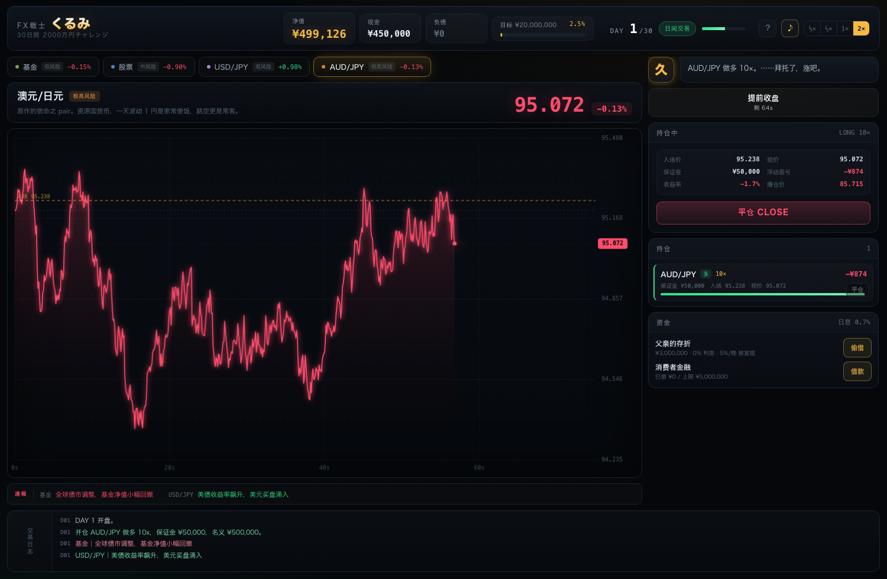

# FX戦士くるみ — 30日間2000万円チャレンジ

一个致敬《FX戦士くるみ》的浏览器模拟交易游戏。30 天，从 50 万日元做到 2000 万，最高 999 倍杠杆。

**双击 `index.html` 即可开始**，无需安装、无需联网、无任何依赖。

> 非官方同人作品。灵感来自漫画《FX戦士くるみ》，与原作及权利方没有任何关联。
> 游戏内的人物、标的、新闻均为虚构，不构成投资建议。



---

## 玩法

| 项目 | 规则 |
| --- | --- |
| 目标 | 30 天内净值达到 **¥20,000,000** |
| 初始资金 | ¥500,000 |
| 每天 | 白天 **120 秒** 实时行情，收盘强制平仓 |
| 播放速度 | 默认 **⅓×**（一天约 6 分钟），可选 ⅔× / 1× / 2×（约 3 / 2 / 1 分钟） |
| 夜晚 | 可以挂单，但只能持到 **次日开盘**，按跳空价结算 |
| 资金杠杆 | 偷借父亲 ¥3,000,000（0 利息，有被发现风险）；消费者金融上限 ¥5,000,000（日息 0.7%） |
| 净值 | 现金 + 持仓权益 − 负债 |

### 四个标的（风险由低到高）

1. **全球平衡基金** — 日波动约 0.4%，只能做多，无法达成目标。
2. **未来電機（股票）** — 日波动约 2.2%，最多 3 倍信用杠杆。
3. **美元/日元** — 日波动约 0.6%，可上 999 倍。
4. **澳元/日元** — 日波动约 1.4%，最喜欢跳空（原作的宿命 pair）。

### 杠杆与爆仓

名义金额 = 保证金 × 杠杆。价格反向波动 **1 / 杠杆** 时保证金全部亏光，仓位被强制平仓：

- 10 倍 → 反向 10% 爆仓
- 100 倍 → 反向 1% 爆仓
- 999 倍 → 反向 **0.1%** 爆仓，几乎是一根 K 线的事

### 三个结局

| 结局 | 条件 |
| --- | --- |
| **百万富翁** | 净值达到 ¥20,000,000（可随时「落袋为安」提前收手） |
| **无事发生** | 撑到第 30 天，净值在 0 ~ 2000 万之间 |
| **空中飞人** | 资不抵债（净值 < 0），或父亲限期未还款 |

### 快捷键

- `空格` 暂停 / 继续（白天行情冻结，方便想清楚再动手）
- `回车` 推进：白天 → 收盘，夜间 → 次日
- `1` `2` `3` `4` 切换标的
- `P` 同样可以暂停

---

## 文件结构

```
fx-kurumi/
├── index.html    页面结构
├── styles.css    全部视觉样式（终端风 + 日漫分镜）
├── engine.js     纯逻辑模拟引擎（行情 / 杠杆 / 债务 / 结局），可在 Node 中直接跑
├── ui.js         交互层（120 秒循环、图表绘制、面板渲染、音效）
└── preview.png   界面截图
```

### 在线游玩（GitHub Pages）

推到 GitHub 后，在仓库 **Settings → Pages** 里把 Source 设成 `main` 分支的 `/ (root)`，
几十秒后就能在 `https://<你的用户名>.github.io/fx-kurumi/` 直接玩，手机也能打开。

`engine.js` 不依赖 DOM，可以这样直接做数值模拟：

```js
const E = require('./engine.js');
const st = E.create(12345);
E.startDay(st);
E.open(st, { assetId: 'audjpy', side: 1, stake: 100000, leverage: 999 });
while (st.dayClock < 120) E.tick(st, 0.25);
E.endDay(st);
E.nextDay(st);
```

---

## 模拟模型说明

- 价格按几何布朗运动演进，叠加肥尾与随机新闻跳空；每个交易日有独立的漂移方向。
- 隔夜跳空独立建模，有概率出现 2%~6% 的大跳空，专门惩罚高杠杆过夜。
- 日息 0.7%，每天夜里复利一次。
- 父亲存折每晚 5% 概率被发现（第 4 天起），发现后限期 3 天还款。
- 引擎使用可复现的伪随机数（mulberry32），同一个种子得到同一局。

## 免责声明

本作为虚构游戏，所有标的、新闻、人物均为虚构或公开市场常识，不构成任何投资建议。
现实中，FX 保证金交易可能导致远超本金的亏损。游戏里的「空中飞人」只是一个结局画面——现实里，任何债务都有协商的余地，任何困境都有走出来的可能。
